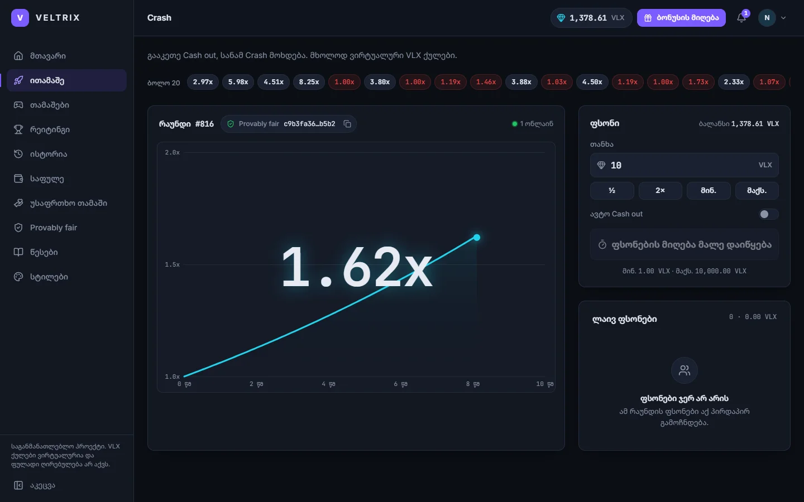
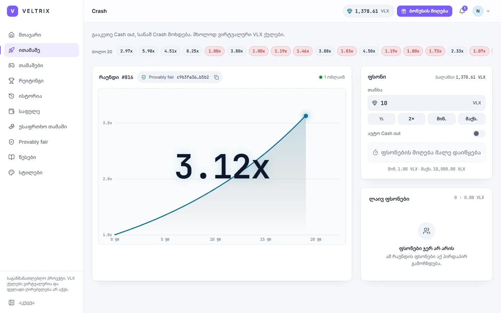
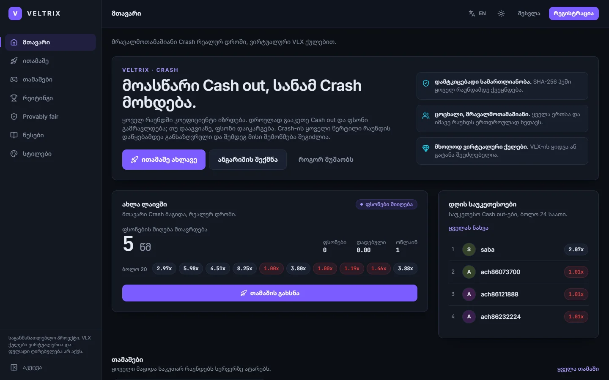
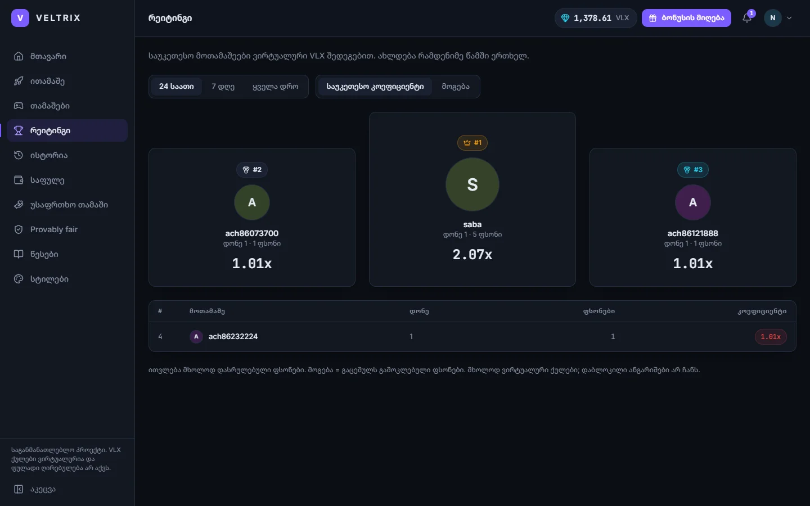
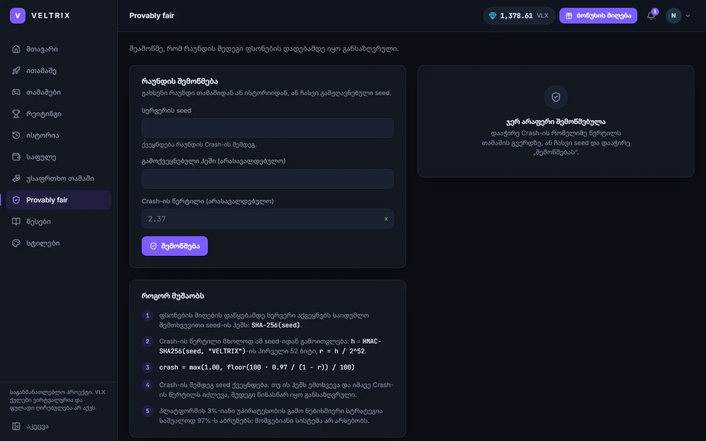
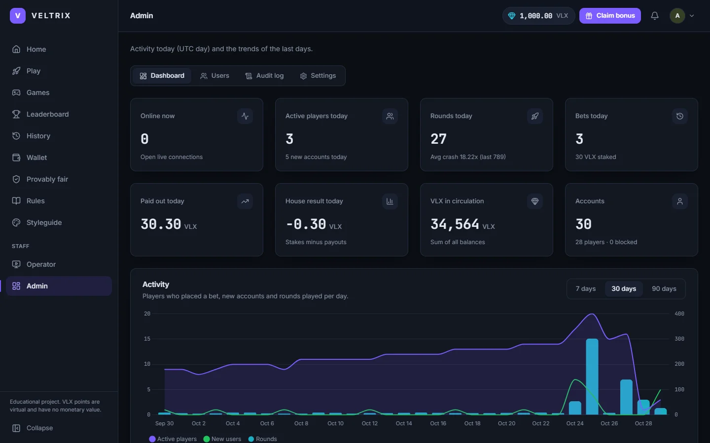
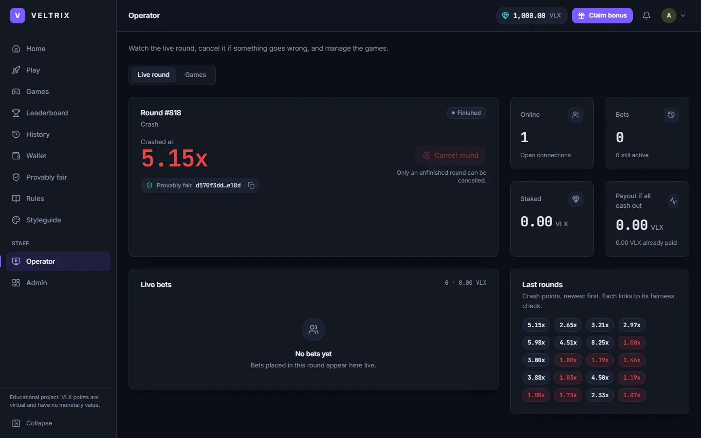
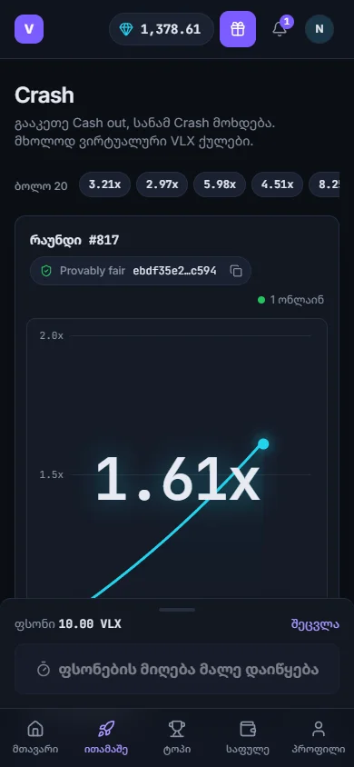
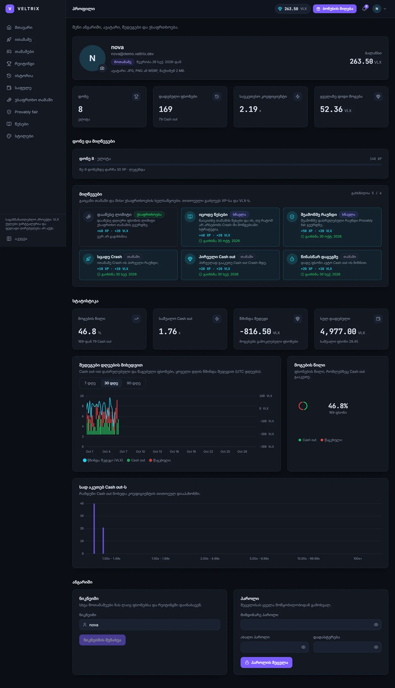
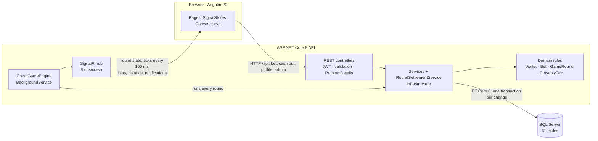

# VELTRIX

A real-time multiplayer web platform whose main module is a **Crash game**: a multiplier grows during a round, and players must cash out before it crashes.

> **Educational / demo project.** Only virtual **VLX points** exist. There are no deposits, purchases, withdrawals or real money. Points come only from the starting balance, the daily bonus and achievements.

**Versions:** [`v1.1-diploma`](#versions) (latest: achievements and XP reworked for responsible play) and `v1.0-diploma` (the first submission, frozen). Exam material: [docs/PRESENTATION.md](docs/PRESENTATION.md) (10-minute demo script and likely questions), [docs/SPEC-COVERAGE.md](docs/SPEC-COVERAGE.md) (every item of the specification and where it is in the code).

## Screenshots

Georgian is the default language; the staff screens are shown in English. All images are in [docs/screenshots](docs/screenshots).

| Crash, dark theme | Crash, light theme |
|---|---|
|  |  |

| Home | Leaderboard |
|---|---|
|  |  |

| Provably fair | Admin dashboard |
|---|---|
|  |  |

| Operator: live round | Phone | Profile: level, achievements, statistics |
|---|---|---|
|  |  |  |

## Tech stack

| Layer | Technologies |
|---|---|
| Backend | C#, ASP.NET Core Web API (.NET 8), EF Core 8 (Code First), SQL Server, SignalR, JWT + refresh tokens, BCrypt, FluentValidation, Serilog, Swagger |
| Frontend | Angular 20 (standalone, zoneless, signals), TypeScript, NgRx SignalStore, @microsoft/signalr, Chart.js, HTML Canvas, Tailwind CSS v4, Angular CDK |
| Tests | xUnit + Moq + WebApplicationFactory integration tests (backend), Jasmine/Karma (frontend) |

## Architecture



The browser only sends requests ("place a bet", "cash out"); the engine on the server decides every result and pushes it to all players.

```
Veltrix.API            → controllers, middleware, filters, auth/Swagger/CORS setup   (depends on Application + Infrastructure)
Veltrix.Application    → DTOs, service interfaces, validators, exceptions            (depends on Domain)
Veltrix.Infrastructure → EF Core DbContext, migrations, service implementations, JWT, BCrypt
Veltrix.Domain         → entities, enums, business rules; no external packages
Veltrix.Tests          → xUnit tests
Veltrix.Web            → Angular client
```

The dependencies point inward. The Domain project knows nothing about the database or the web, so its rules can be unit-tested in isolation.

Inside `Veltrix.Web/src/app`:

```
core/      models (DTO types), api/ (HTTP services), auth/ (AuthStore, interceptor, guards),
           http/ (error + loading interceptors), realtime/ (CrashHub: one shared SignalR connection),
           state/ (WalletStore, NotificationsStore, LimitsStore), ui/ (toasts, theme, layout)
features/  auth, crash (CrashStore, Canvas chart, bet panel, live bets, history strip), wallet, history, profile (+ level, achievements, statistics), players,
           fairness, leaderboard, limits (responsible play, session reminder), operator, admin
layout/    sidebar, top bar, bottom nav, notifications panel
shared/    ui/ (design system components), pipes, validators, formatters
```

## Design system

The UI follows [docs/DESIGN.md](docs/DESIGN.md): tokens, fonts, layout, components, motion and accessibility rules. In development, `/styleguide` shows every component in both themes.

## Specification coverage

[docs/SPEC-COVERAGE.md](docs/SPEC-COVERAGE.md) checks every item of the specification (sections 1–8: features 4.1–4.11, API endpoints, data models, quality and delivery) against the code: done / partial / missing, with the file that implements it. Optional (\*) items are listed separately.

## Setup on a clean PC (Windows)

**1. Install**

- .NET SDK 8 or newer, plus the **ASP.NET Core 8 runtime** (`winget install Microsoft.DotNet.SDK.8` / `winget install Microsoft.DotNet.AspNetCore.8`)
- SQL Server 2019 or newer (Express or Developer edition), default instance, Windows authentication; `sqlcmd` comes with it
- Node.js 22 LTS (20.19+, 22.12+ and 24 also work)
- Git. Optional: EF Core tools (`dotnet tool install --global dotnet-ef`) and the Angular CLI (`npm install -g @angular/cli@20`)

**2. Get the code**

```bash
git clone <repository-url> Veltrix
cd Veltrix
git checkout v1.0-diploma        # the submitted version (optional)
```

**3. JWT signing key.** It is a secret, so it lives in user-secrets and never in Git (any random text of 32+ characters):

```bash
dotnet user-secrets set "Jwt:Key" "<any-random-string-of-at-least-32-characters>" --project Veltrix.API
```

**4. Database: choose one**

- **A. Automatic (recommended).** Nothing to do: in Development the API creates the `Veltrix` database with the migrations, adds the test accounts and, once, the demo players.
- **B. One SQL script.** [`database/veltrix.sql`](database/veltrix.sql) builds the same database without EF tools: every migration (31 tables, constraints, reference data) plus the four test accounts. It checks before every step, so running it twice is safe.

  ```bash
  sqlcmd -S localhost -E -Q "CREATE DATABASE Veltrix"
  sqlcmd -S localhost -E -d Veltrix -i database/veltrix.sql
  ```

  In SSMS: create the database, open the file, select the database, Execute. The demo players are not in the script: they are played by the real game code on the first Development start.

Another SQL Server: change `ConnectionStrings:DefaultConnection` in `Veltrix.API/appsettings.json`.

**5. Run the API**

```bash
dotnet run --project Veltrix.API --launch-profile http
```

Swagger UI: http://localhost:5295/swagger

**API in Postman:** File → Import → choose [`docs/api/openapi.json`](docs/api/openapi.json) (or the live URL `http://localhost:5295/swagger/v1/swagger.json`). Postman creates a request for every endpoint; set the collection's Bearer token to the `accessToken` from `POST /api/auth/login`.

To apply migrations manually instead:

```bash
dotnet ef database update --project Veltrix.Infrastructure --startup-project Veltrix.API
```

**6. Run the client** (in a second terminal, with the API running)

```bash
cd Veltrix.Web
npm install
npm start          # ng serve → http://localhost:4200
```

`proxy.conf.json` forwards `/api`, `/hubs` (WebSockets) and `/uploads` to the API at `http://localhost:5295`. The browser therefore sees one origin, and the client only uses relative URLs.

Open http://localhost:4200. To demo multiplayer, use two browser windows (or one normal and one private window) logged in as `player1` and `player2`. In development, the login page has one-click buttons for the test accounts.

## Test accounts (Development seed)

| Role | Email | Password | What to try |
|---|---|---|---|
| Admin | admin@veltrix.dev | Admin123! | Admin dashboard, users (role, block, balance adjustment), audit log, settings; everything the operator can do |
| Operator | operator@veltrix.dev | Operator123! | Operator panel: live round monitor, cancel a round (automatic refunds), games and their status |
| Player | player1@veltrix.dev | Player123! | Bet, cash out, auto cash-out, wallet and daily bonus, history, profile with level and achievements, limits, settings |
| Player | player2@veltrix.dev | Player123! | The second player for a multiplayer demo |
| Guest | — | — | Home, games, the live round (watch only), leaderboard, rules, provably fair, public player profiles |

Each account starts with 1000 VLX. The `crash` game and the system settings come from the migration itself (`HasData`).

### Demo data (Development only)

So that the leaderboard, the charts and the admin dashboard are not empty in a demo, the first Development start also creates **15 demo players with 30 days of play** (about 230 rounds and 1300 bets; it takes about half a minute, once). They log in with `<nickname>@demo.veltrix.dev` / `Player123!`, e.g. `nova@demo.veltrix.dev`.

The demo history is played by the same code as a real game (`DemoDataSeeder`), only with a clock set to moments in the past:

- every round has a real random seed, hash and crash point, so "verify this round" works for it;
- every bet passes `Bet.Place` and takes the stake from the wallet with a ledger row; a player who runs out of points comes back only through the daily bonus;
- cash-outs happen below the crash point (auto cash-out through the engine's settlement code, or "by hand" at the server multiplier of that moment);
- the crash settles the remaining bets as lost and updates the player statistics; the admin daily statistics are recalculated for the days that got demo bets.

It runs only when `Database:SeedDemoData` is `true` (set in `appsettings.Development.json`) and is skipped once the demo players exist. An integration test (`DemoDataSeederTests`) checks these rules on SQL Server.

## Database

There are 31 tables, created by the migrations `InitialCreate` and `AddExtendedModels` (later migrations add columns, constraints and indexes, and `AssistantMessages` adds the AI assistant's table):

| Area | Tables |
|---|---|
| Core (spec §6) | `Users, RefreshTokens, Wallets, WalletTransactions, Games, GameRounds, Bets, PlayerLimits, Notifications, AuditLogs, SystemSettings` |
| Security | `PasswordResetCodes, EmailVerificationCodes, UserTwoFactors, LoginAttempts` |
| Responsible play | `PlaySessions, SelfExclusions` |
| Profile and progress | `UserPreferences, PlayerStats, Levels, Achievements, UserAchievements` |
| Game engine | `AutoBetConfigs, GameRoundEvents, RoundCancellations` |
| Admin and content | `BalanceAdjustments, ChatMessages, ChatMutes, DailyStatistics, StaticPages` |
| AI assistant | `AssistantMessages` |

Seeded reference data: the `crash` game, system settings, 10 levels (0–200 XP), 10 achievements (6 active, 4 retired), and 2 content pages. There are 8 migrations; [`database/veltrix.sql`](database/veltrix.sql) is all of them plus the test accounts in one script (setup step 4B). A test (`DatabaseScriptTests`) fails if a migration is added without regenerating it:

```bash
dotnet ef migrations script --idempotent --project Veltrix.Infrastructure --startup-project Veltrix.API -o <file>
```

(then keep the header and the test-accounts part at the end of `database/veltrix.sql`).

Integrity is enforced in the database itself, not only in C#:

- CHECK constraints: balance ≥ 0, `BalanceAfter = BalanceBefore + Amount`, bet amount > 0, slot ∈ {1,2}, crash point ≥ 1, and more
- Unique indexes: email, nickname, game slug, wallet per user, transaction idempotency key, `(RoundId, UserId, Slot)` for bets
- `RowVersion` on `Wallets` for optimistic concurrency

## Crash game engine

A `BackgroundService` (`CrashGameEngine`) runs one loop per Crash game. The browser never drives the game.

```
Waiting → BettingOpen (10 s) → BettingClosed (1 s) → Running (100 ms ticks) → Crashed → Finished → pause (5 s)
                    any unfinished state ──────────────────────────────────→ Cancelled (all active bets refunded)
```

- **Provably fair:** before the round, the server picks a random 32-byte `serverSeed` and publishes `SHA-256(serverSeed)`. The crash point is `max(1, floor(100 · 0.97 / (1 − r)) / 100)`, where `r` is the first 52 bits of `HMAC-SHA256(serverSeed, "VELTRIX")` divided by 2^52. After the crash, the seed is revealed. Check any round with `GET /api/fairness/rounds/{id}` or `POST /api/fairness/verify`.
- **Multiplier:** `m(t) = e^(0.00006·ms)`, rounded down to 2 decimals. Cash-out uses the server's clock, never a value from the client.
- **Wallet:** every change is a `WalletTransaction` (before/after balance, unique idempotency key). `RowVersion` on wallets and `Status` on bets detect concurrent changes; the operation is then retried with fresh data.
- **Restart safety:** on startup, unfinished rounds are cancelled and their bets refunded.

## Player tools and admin panel (Phase 4)

| Area | Endpoints | Who |
|---|---|---|
| Leaderboard | `GET /api/leaderboard?period=day\|week\|all&type=multiplier\|profit&limit=20` | everyone (guests too) |
| Personal stats | `GET /api/stats/me?days=30` | logged in |
| Limits | `GET /api/limits`, `PUT /api/limits`, `POST /api/limits/self-exclusion` | Player |
| Notifications | `GET /api/notifications`, `PUT /api/notifications/{id}/read`, `PUT /api/notifications/read-all` | logged in |
| Admin users | `GET /api/admin/users?search=&role=&isBlocked=&page=`, `GET /api/admin/users/{id}`, `PUT …/{id}/role`, `PUT …/{id}/block`, `POST …/{id}/balance-adjustment` | Admin |
| Audit log | `GET /api/admin/audit-logs?action=&entityType=&entityId=&page=`, `GET /api/admin/audit-logs/actions` | Admin |
| Settings | `GET /api/admin/settings`, `PUT /api/admin/settings` (starting balance, daily bonus) | Admin |
| Dashboard | `GET /api/admin/stats/overview`, `GET /api/admin/stats/daily?from=&to=` | Admin |

Rules (all in Domain entities, all unit-tested):

- **Daily bet limit** (`PlayerLimit`): a lower limit applies at once; a higher limit or removing it waits **24 hours**. Otherwise a player on a losing streak could just raise it. The bet service checks it inside the same retried unit of work as the wallet debit, so two simultaneous bets cannot both slip under the limit.
- **Self-exclusion** (24 h / 7 d / 30 d): betting is refused with 403. It can be extended but never shortened or cancelled. The player can still sign in and see their history.
- **Balance adjustment** (`BalanceAdjustment.Apply`): a reason (5–500 characters) is required, the amount is never 0, the balance never goes negative, and an admin cannot adjust their own balance. It creates an `AdminAdjustment` ledger row, an audit entry and a notification in one transaction. An optional `requestId` makes it idempotent (a double-click cannot pay twice).
- **Role and block** (`User`): nobody can change their own role or block themselves, so the system can never lose its last admin. Blocking signs the user out on every device and refuses their bets at once.
- **Audit log:** every admin action (and limit changes and self-exclusions) records who did it, the old value and the new value.

Background jobs (`Infrastructure/Jobs`):

- `DailyBonusReminderJob` (every minute): creates a "Daily bonus available" notification once per bonus cycle and pushes it live. It skips blocked and self-excluded players.
- `DailyStatisticsJob` (startup, then every 10 minutes): stores one `DailyStatistics` row per finished day, so the admin charts read about 30 small rows instead of scanning every bet. Today is always calculated live.

The admin dashboard shows the crash points of the last 1000 rounds next to the share the formula predicts (`P(crash ≥ x) = 0.97 / x`). Over many rounds the two must match. A unit test checks this on 20,000 generated rounds.

Pages (Angular):

| Page | Who | What |
|---|---|---|
| `/` (Home) | everyone | the live round, available games, top players of the day |
| `/games` | everyone | games catalog: search, type and status filters; `/crash/:slug` opens any Crash game |
| `/players/:nickname` | everyone | public profile: level with progress to the next one, achievement badges, totals, best cash-outs |
| `/rules` | everyone | game rules and "why there is no winning strategy" (from the `StaticPages` table, `GET /api/pages/{slug}`) |
| `/settings` | logged in | theme (System / Dark / Light), game sounds, animations; saved on the account (`GET/PUT /api/profile/preferences`) |
| `/leaderboard` | everyone | 24 hours / 7 days / all time × best multiplier / profit; podium + table, my rank highlighted |
| `/profile` → Level and achievements | players | XP and progress to the next level; every task with its kind (safety, learning, playing) and reward, unlocked ones with the date; tasks that ask to play are hidden while the player cannot bet |
| `/profile` → Statistics | players | win rate, average cash-out, net result, charts (results per day, win rate, cash-out ranges) |
| `/limits` (Responsible play) | players | daily limit with today's usage, session reminder, self-exclusion with a confirm dialog |
| bell (top bar) | logged in | unread badge, latest notifications, mark read; new ones arrive live |
| `/operator` | Operator, Admin | live round monitor, cancel round (reason, automatic refunds), games and their status |
| `/admin`, `/admin/users`, `/admin/audit`, `/admin/settings` | Admin | dashboard charts, users + drawer (role, block, balance adjustment), audit log, settings |

The browser keeps **one** SignalR connection per tab: the logged-in user receives balance and notifications on every page, and the Crash page (or the operator monitor) joins its game group on the same connection, so the online counter counts each tab once. Chart.js and the SignalR client are loaded on demand, so the first download stays under 500 kB.

The **session reminder** (every 60 minutes by default) runs in the browser: it is advice. The hard rules (daily limit, self-exclusion) are enforced by the server on every bet.

## Achievements and levels (responsible play, v1.1)

| Endpoint | Who |
|---|---|
| `GET /api/achievements`: the active tasks (safety and learning first) with their XP / VLX reward and how many players completed each | everyone |
| `GET /api/achievements/my`: completed ones with the date; `playTasksHidden` = tasks that ask to play were left out | logged in |
| `POST /api/pages/{slug}/read`: the Rules page read to its end ("Know the rules") | Player |
| `GET /api/limits` → `canPlayNow`: false while self-excluded or when today's limit is used up | Player |
| `GET /api/players/{nickname}`: also XP, the next level and the badges | everyone |

**Rules (the author's):** no XP, task or achievement rewards betting volume, the amount staked, the number of bets or the time played; learning and safety are preferred; a player who cannot bet right now sees nothing that asks them to play.

| Task | Kind | Completed when | XP / VLX |
|---|---|---|---|
| Set your limit | Safety | the player saves a daily bet limit | 60 / 20 |
| Know the rules | Learn | the end of the Rules page stays on screen for 10 s | 40 / 20 |
| Check a round | Learn | the player verifies a REAL finished round (its seed matches a published hash) on the Provably fair page | 50 / 20 |
| Try Crash | Play | the first bet is settled | 10 / 10 |
| First cash-out | Play | the first cash-out | 20 / 20 |
| Plan ahead | Play | a bet with an auto cash-out target is settled, won or lost | 20 / 10 |

- **XP comes only from these tasks**; a bet gives none. 10 levels from 0 to 200 XP: playing alone reaches level 4 at most, the top level needs every learning and safety task. A level-up sends a notification.
- **Retired** (they rewarded volume or stake size): 100 bets, 50 cash-outs, a 1000 VLX win, a 10x cash-out. The rows stay inactive because old ledger rows name them; the migration `ResponsibleAchievements` recalculated every player's XP from the active tasks.
- **Awarded by the server only:** Play tasks in the same transaction that settles the round, the others right after their action (`AchievementAwarder`). The `UserAchievement` row (one per player and task), the XP, the VLX reward as a normal wallet credit with a ledger row (idempotency key `achievement:{user}:{code}`) and a notification: a reward can never be paid twice. The rules are plain domain code (`Domain/Progress`), unit-tested without a database.
- **A player who cannot bet** (self-excluded, or less than the smallest bet left of today's limit) sees no play tasks (with a note why), "Betting paused / Daily limit reached until …" instead of "Place bet", **Watch** instead of **Play** on game cards, no "Play now" / "Play a round" buttons, and "Close" instead of "Keep playing" in the session reminder. One rule decides it on the server (`PlayerLimit.CanStillBetToday`), for the API and the UI alike.

## Real-time (SignalR) — `/hubs/crash`

Connect as a guest, or with `?access_token=<JWT>` to also receive your balance and notifications.

| Direction | Message | Payload |
|---|---|---|
| client → server | `JoinGame(slug)`, `LeaveGame(slug)` | |
| server → group | `RoundStateChanged` | roundId, roundNumber, state, serverSeedHash, bettingEndsAt, startedAt |
| server → group | `MultiplierTick` | roundId, multiplier, elapsedMs |
| server → group | `RoundCrashed` | roundId, crashPoint, serverSeed |
| server → group | `BetPlaced` / `PlayerCashedOut` | roundId, nickname, amount / multiplier, payout |
| server → user | `BalanceUpdated` | balance |
| server → user | `Notification` | id, type, title, message, isRead, createdAt |
| server → all | `OnlineCount` | count |

## Languages (Georgian and English)

The interface is in **Georgian by default** and in English. Guests switch with the language button in the top bar; logged-in users in Settings → Language (or the account menu). The choice applies at once, without a reload, and is saved on the account (`UserPreference.Language`).

- The code is written in English, and the English text is the key: `{{ 'Place bet' | t }}`. **All Georgian text is in one file, [`Veltrix.Web/src/i18n/ka.json`](Veltrix.Web/src/i18n/ka.json)**: `ui` (the interface), `server` (messages the API sends: errors, notifications, ledger reasons, level titles) and `pages` (the Rules pages). A missing translation shows the English text, never a broken key.
- The API speaks English. The client shows its messages in Georgian by looking them up in `server`; changing parts are placeholders (`Bet must be between {min} and {max} VLX.`).
- Crash, Cash out and VLX keep their names. Amounts and multipliers keep one format (`1,234.56 VLX`, `2.35x`); dates use Georgian month names.
- The Georgian file and the Georgian date names are their own lazy chunk: English visitors never download them.
- Checks: `npm run i18n:check` (every text in the code has Georgian, nothing unused), Jasmine (`i18n.spec.ts`: placeholders and terms preserved, live switching) and xUnit (`GeorgianTranslationTests`: every user-facing API message has Georgian).

## Tests

```bash
dotnet test
```

There are 304 xUnit tests in three groups:

- **Integration tests** (`Veltrix.Tests/Integration`, 39 tests): `WebApplicationFactory` starts the real API in memory (same `Program.cs`, middleware, JWT, validation, rate limits, EF Core) against a **throwaway SQL Server database** `Veltrix_Tests_<random>`, created by the migrations and dropped at the end, and calls it over HTTP. The crash engine's background loop is off, so each test moves its own round through the states with `RoundSettlementService` (the engine's own code) and a clock it can stop. Covered: register / login / validation errors per field / duplicate email; 401 without or with a forged token; refresh-token rotation, logout, the 30-second reuse window and the theft alarm (an old token replayed later logs out every session); the auth rate limit (11th login from one IP → 429, refresh not limited); a bet takes the stake and writes a ledger row; bets refused after betting closes, below the minimum, with 3 decimals, twice in one slot, or above the balance; cash-out pays the stake × the **server's** multiplier at the moment of the request; too late after the crash point; the crash settles the bet as lost and reveals the crash point; an operator's cancel refunds active bets while cash-outs keep their payout; only players can bet; a blocked player is refused even with a token issued before the block; a self-excluded player cannot bet; every `api/admin` endpoint answers 401 / 403 / 403 / 200 to guest / player / operator / admin; only staff can cancel a round; an admin cannot change their own role, block themselves or adjust their own balance; a balance adjustment writes a ledger row and an audit entry; a promoted player gets the new role at the next login; a new account starts in Georgian and can save English (other languages refused); the first settled bet unlocks "Try Crash" once, with its XP, a VLX ledger row and a notification, and more or bigger bets add no XP; an auto cash-out win completes the three play tasks at once, a lost bet with an auto target completes "Plan ahead"; verifying a real finished round completes "Check a round" (a made-up seed does not, staff collect nothing); reading the rules and saving a daily limit complete their tasks; a self-excluded player and one whose daily limit is used up get no play tasks and `canPlayNow` false; the demo data follows the game rules (ledger chain, no negative balance, cash-outs below the crash point, verifiable crash points, statistics, created only once). They need a SQL Server: `localhost` with Windows login by default, or set `VELTRIX_TEST_SQL` to another connection string (without a database name).
- **Service tests with Moq** (`Veltrix.Tests/Services`) run the real services against EF Core's in-memory database, with Moq fakes for "who is calling" and the SignalR notifier, and check both the saved data and the live events sent (wallet, limits, admin actions, preferences, content pages, the daily-bonus job).
- **Domain and API tests** check that every user-facing API message has a Georgian version in `ka.json` (`GeorgianTranslationTests`) and that `database/veltrix.sql` contains every migration (`DatabaseScriptTests`), and cover XP, levels and achievement rules (`ProgressionTests`), the responsible-play rules (`ResponsibleAchievementTests`: playing 100,000 times with huge stakes earns nothing more than playing once, every task is a single step, learning and safety outweigh play, no play tasks for a player who cannot bet), crash-point generation and distribution, provably fair verification, multiplier curve, round state transitions (illegal ones rejected), wallet rules (no negative balance, refunds, daily bonus), bet and cash-out rules, refresh-token reuse rules, daily bet limit (24-hour wait before an increase), self-exclusion, admin balance adjustment, role and block rules, crash-point ranges against the theoretical distribution, guards that no role-protected endpoint is accidentally `[AllowAnonymous]` and that every `api/admin` controller requires the Admin role, and which auth endpoints are rate-limited.

```bash
cd Veltrix.Web
npx ng test --watch=false --browsers=ChromeHeadless
```

There are 134 Jasmine tests:

- Languages (`I18n`, pipes, `ka.json`): English as written, Georgian after switching, English fallback for a missing text, API messages with changing values (patterns), live re-render without a reload, Georgian word order with `tSplit`, and for every entry of ka.json the same `{placeholders}`, the terms Crash / Cash out / VLX kept, only `<code>` HTML

- `AuthStore`: login, a single refresh shared by concurrent requests, a failed refresh ends the session, logout
- `WalletStore`, `LimitsStore`: balance, daily bonus (success / refused), filters, self-exclusion, refused updates
- `PreferencesStore`: animations off = reduced motion, guests keep settings locally, logged-in players save them, the account's settings win after login, Georgian by default and the language switch
- `ToastStore`, `ThemeService`: max 4 toasts, errors stay longer; System / Dark / Light
- HTTP interceptors: ProblemDetails message as a toast, quiet for 401 and silent requests, loading bar counting
- Auth interceptor: the access token goes to API calls only (not to /api/auth or other files), a 401 triggers ONE refresh and a retry with the new token, a failed refresh ends the session, no refresh for guests or for 403
- ProblemDetails helpers: any error becomes one toast sentence, server validation errors appear next to the matching form fields
- Form validators (same rules as the server): nickname, strong password, 18+, password confirmation, 2 decimals
- `SoundService`, `LayoutService`: silent while sounds are off, one audio context; the collapsed sidebar is remembered
- Markdown (rules pages): lists, bold / italic, HTML stays text, no extra spaces
- `CrashStore`: SignalR events → state (new round, crash, auto cash-out, cancel/refund), countdown on the server clock, extrapolation limit, game sounds (once per result)
- `CrashHub`: one shared SignalR connection for the user and the game page, the online count handed to a page that joins later, leave / logout, a new connection for a new identity, personal vs game events
- `NotificationsStore`: load, live notifications (deduplicated), optimistic mark read / mark all read, a role change refreshes the token and leaves a forbidden page, a block signs the user out, an achievement toast names the achievement and its reward
- `roleGuard`: the right roles get in, others go back to the game, guests go to the login page
- Bet panel: the one big button (`betAction`), including "betting paused" for a self-excluded player and "daily limit reached" at the limit (a bet already in the round can still be cashed out)
- Responsible play: the achievements note when play tasks are hidden, kind badges, **Watch** instead of **Play** on a game card, the Rules page tells the server only after its end was on screen for 10 s (and only for players), `LimitsStore.canPlayNow`
- Session reminder (`play-session`): continuous play, breaks, reminders every N minutes
- Audit log text: "Role: Player → Operator", readable dates
- Crash math: the browser reproduces 7 real server rounds (seed → SHA-256 hash → crash point), proving both implementations are identical
- App shell: sidebar / top bar / bottom nav, guest navigation, collapsible sidebar, theme toggle

## Development notes

- The password reset code is "emailed" to the API console and log file (`Veltrix.API/Logs/`) in development.
- Logs: console + daily rolling file via Serilog.
- Git flow: `main` ← `develop` ← `feature/*`.

## Versions

| Tag | What |
|---|---|
| `v1.0-diploma` | The first version submitted for the diploma. It is frozen: never moved or re-tagged; later work happens on new branches |
| `v1.1-diploma` | v1.0 + the responsible-play review: XP and achievements never reward betting volume, stakes, the number of bets or time; learning and safety tasks; nothing invites a self-excluded player or one at the daily limit to play |

To look at or run exactly one version:

```bash
git checkout v1.1-diploma                         # read-only look ("detached HEAD"); same for v1.0-diploma
git switch -c my-fix v1.1-diploma                 # or start a new branch from it
git diff v1.0-diploma v1.1-diploma --stat         # what v1.1 changed
```
